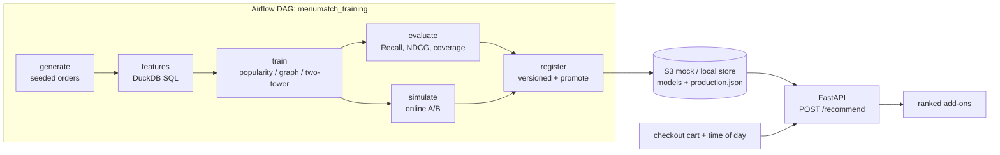

# MenuMatch: Restaurant Item Recommender with Offline and Online Evaluation

An end-to-end recommendation system that suggests add-on menu items (sides, drinks, desserts) at checkout from restaurant order data, with offline metrics and a simulated online test.

## Results

Default config (seed 7, 120 days, ~300 orders/day). Offline: chronological hold-out of the last 20% of days, 6,746 test baskets, one add-on held out per basket. Online: 30k simulated sessions, top-3 shown, popularity as control (95% CIs in `online.json`).

| Model | NDCG@10 (95% CI) | Recall@5 | Simulated conversion lift | Simulated add-on revenue/session lift |
|---|---|---|---|---|
| Popularity baseline | 0.586 (0.580–0.592) | 0.768 | n/a (control) | n/a (control) |
| Item-item graph (co-occurrence) | 0.693 (0.686–0.698) | 0.883 | +16.8% | +36.8% |
| **Two-tower (PyTorch)** | **0.718 (0.712–0.723)** | **0.917** | **+19.7%** | **+41.5%** |

Two-tower improves NDCG@10 by **22.4%** over popularity (and 3.5% over the graph model); serving p99 is **16.5 ms** (p50 4.7 ms) over HTTP.

Caveats: the data is synthetic, so these show the harness works and the models rank sensibly, not real-world lift. Each restaurant has only 10-11 candidate add-ons, so Recall@10 is ~99% for every model and NDCG@10 is driven by rank order; Recall@1/3/5 are in `metrics.json`. Latency was measured with `scripts/bench_latency.py` (3,000 sequential requests after 100 warm-up, k=10, one uvicorn worker, loopback, 2-vCPU VPS, CPU-only PyTorch); expect different numbers on other hardware.

**Resume line** (numbers from the table above):
> Built a restaurant add-on recommender (PyTorch, Airflow, DuckDB); two-tower model improved NDCG@10 by 22% over popularity baseline; served via FastAPI at p99 < 20 ms.

## Architecture



## Demo

`scripts/demo.sh` runs the whole story in about a minute for a screen recording: the Airflow DAG against a local S3 mock, then serving and a `curl` that returns recommendations. A recorded GIF is not committed to the repo; record one with any terminal recorder (for example `asciinema` + `agg`) while running the script.

## Features

- **Seeded synthetic order generator**: 5 restaurants with real-looking menus, time-of-day and weekend effects, basket patterns driven by hidden item affinities, and a slow popularity trend so the time split matters.
- **SQL feature tables in DuckDB** (`menumatch/sql/*.sql`): enriched orders, train-only item stats / daypart stats / co-occurrence edges, and leave-one-out training and evaluation examples.
- **Three models**: popularity baseline, item-item co-occurrence graph (cosine + 2-hop walk), and a PyTorch two-tower model (cart/context tower and item tower, masked full-softmax).
- **Offline harness**: Recall@K, NDCG@K, catalog coverage@K with bootstrap CIs, on chronological train/val/test splits.
- **Simulated online A/B/n test**: randomised assignment, ground-truth acceptance propensities, conversion/revenue lift with p-values and CIs.
- **Airflow DAG** (generate → features → train → evaluate + simulate → register) that registers versioned models to an S3-compatible artifact store (boto3 against a local moto server, or a local folder).
- **FastAPI service** (`POST /recommend`), pytest suite, GitHub Actions CI, Dockerfile and docker-compose.

## Architecture

```
generator ──> parquet ──> DuckDB SQL features ──> models (pop / co-occ / two-tower)
 (World)      raw/         train/val/test            │
                           examples                 ├─> offline evaluation (test split)
                                                    ├─> online simulation (fresh sessions from World)
                                                    └─> registry (S3 mock / local) ──> FastAPI /recommend
```

```
menumatch/
  generator.py      synthetic world + orders        features.py + sql/   DuckDB feature pipeline
  models/           popularity, cooccurrence, twotower
  evaluation.py     Recall/NDCG/coverage            simulation.py        online A/B simulation
  store.py          S3Store / LocalStore            registry.py          versioning + promotion
  pipeline.py, cli.py   stages                      serving/app.py      FastAPI
dags/menumatch_dag.py   Airflow DAG                 tests/               pytest suite
```

## Setup

Python 3.10+ (developed on 3.12).

```bash
python -m venv .venv && source .venv/bin/activate
make install            # CPU torch wheel + project + dev deps
cp .env.example .env    # optional: every setting has a safe local default
```

No real secrets are needed. The S3 mock uses dummy credentials (`test`/`test`).

## Run

```bash
make pipeline           # all stages in-process (~1 min); prints offline + online results
make serve              # API on :8000, override with PORT=8001 (serves the promoted model)
curl -s localhost:8000/recommend -H 'content-type: application/json' \
  -d '{"restaurant_id":0,"cart_item_ids":[0],"k":3,"hour":19}'
```

Latency check (server running): `python scripts/bench_latency.py --url http://localhost:8000`.

Individual stages: `python -m menumatch.cli {generate,features,train,evaluate,simulate,register} --run-id demo`.
Outputs go to `data/runs/<run_id>/`; registered models go to `artifacts/` (local store).

**With the S3 mock** (mirrors AWS usage; boto3 talks to a moto server):

```bash
make s3                                   # terminal 1: moto_server on :5000
export MENUMATCH_STORE=s3 MENUMATCH_S3_ENDPOINT=http://localhost:5000
export AWS_ACCESS_KEY_ID=test AWS_SECRET_ACCESS_KEY=test AWS_DEFAULT_REGION=us-east-1
make pipeline && make serve
```

**Docker**: `docker compose up --build` starts moto S3, runs the pipeline once, then serves the API on :8000.

**Airflow** (local, no scheduler needed): `pip install "apache-airflow==3.0.6" --constraint https://raw.githubusercontent.com/apache/airflow/constraints-3.0.6/constraints-3.12.txt`,
`airflow db migrate`, then `make airflow-test` (runs the DAG once). To schedule it, point `dags_folder` at `dags/`. Tasks call `$MENUMATCH_PYTHON -m menumatch.cli <stage>`, so set `MENUMATCH_PYTHON` to the project's interpreter.

## Test

```bash
make test        # 26+ tests; DAG test is skipped unless apache-airflow is installed
```

CI (`.github/workflows/ci.yml`) runs the tests, a pipeline smoke run, a DAG check under Airflow, and a Docker build.

## API

- `POST /recommend` body `{restaurant_id, cart_item_ids?, k=3, hour?, is_weekend?}` → ranked add-ons with name, category, price, score, plus model kind/version. 404 for unknown restaurant, 422 for items not on that menu, 503 if no model is registered.
- `GET /health`, `GET /restaurants/{id}/menu`, `POST /reload` (re-read the production model).

## Key design decisions

- **Task framing**: the "add-on" task is *given the cart, rank sides/drinks/desserts of the same restaurant*. Candidates exclude mains, other restaurants and items already in the cart; the same mask is used in training, evaluation and serving.
- **Leakage control**: splits are chronological and day-aligned (70/10/20 train/val/test). Every feature table is computed from `split = 'train'` rows only, and a test proves features and training examples are unchanged when future data is removed. Val is used only for two-tower early stopping.
- **Evaluation protocol**: one add-on per test basket is held out via a deterministic hash (reproducible); the rest of the basket is the cart. With one relevant item, Recall@K is the hit rate and NDCG@K is 1/log2(rank+1).
- **Why a simulator for "online"**: the generator's hidden propensities act as the true customer, so the A/B can measure real behaviour for items a model recommends that were never held out. It uses randomised assignment and common random numbers across arms, and the sessions come from days after the data window.
- **Two-tower**: full softmax over valid candidates (only dozens per restaurant) instead of sampled negatives, so training matches the serving candidate set. Weights are saved as npz plus JSON, with no pickle.
- **Registry**: versions `v0001…` per model kind; the best model by test NDCG@5 is promoted to `production.json` unless it regresses the current production metric (`force` overrides). Run metrics are not comparable across different datasets, so treat the gate as a safety net, not a full champion/challenger system.
- **S3 mirroring**: the store interface has an S3 backend (boto3, any endpoint) and a local-folder backend with the identical key layout, so the project runs with zero services by default.
- **Airflow**: tasks shell out to the CLI so the scheduler environment stays separate from the heavy ML dependencies, and run ids are sanitised for paths/keys.
- **Limitations**: synthetic data only; no user identities (cart + context only); the nightly DAG regenerates data rather than ingesting real orders, so swap `generate` for an extract step to use real data.
